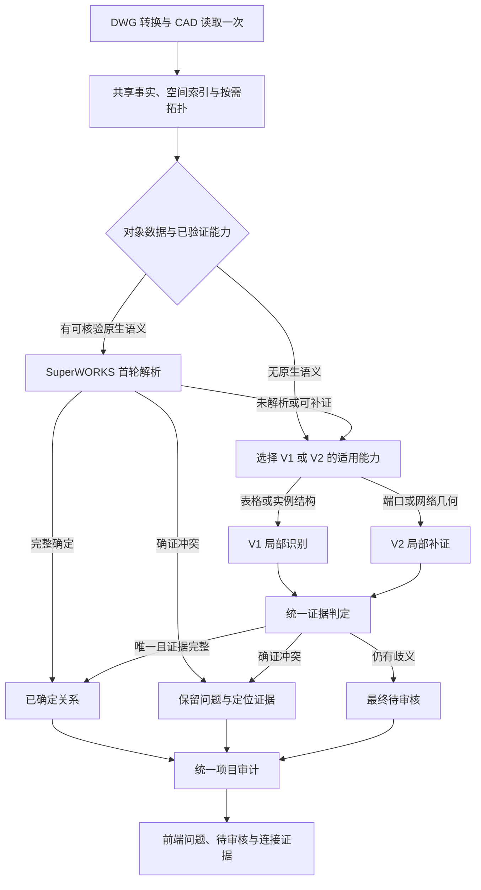

# SuperWORKS、V1、V2 协同识别架构

状态：修订设计稿，2026-10-13；依据当前 `f9b9770` 的生产代码与 round25 回放。只设计，不实施生产重构或运行新的基准测试。本轮及后续只本地提交；未经用户要求不推送远端，可在实施完成后整理或 squash。

## 1. 架构决策

采用 **共享 CAD 与拓扑基础层 + 按对象可用数据选择首轮能力 + 按缺口补证 + 统一判定与项目审计**。

有可核验的 SW 原生端口/行/接线元数据时，SW 优先解析；只有 SW 图框或文件来源标记不算对象有可用语义。没有这些数据的表格和既有实例结构先交 V1；物理端口/路径方面需要 V2 时按能力调用。先按领域的已验证准确性与可用性准入，再比较同等质量下的覆盖和速度，不预设一个引擎在全部领域最好。

保留页型路由，用它选择图种能力；增加对象/关系级调度，用它决定是否需要运行某个引擎。调度单位是端口、导线关系、元件实例端口、表格物理行及局部网络，不是整页。SuperWORKS 完整解决的主张不再交给 V1/V2 重复识别。下游可以读取已确定对象作为上下文，但不能改写其身份或连接。

V1 与 V2 不固定全量串行，也不全量并行。V1 擅长既有页型、表格和实例结构规则；V2 提供物理端口、几何拓扑与候选约束。缺什么能力就调用什么能力，需要两者时才组合。

用户规则落地为：确证冲突直接进入前端问题列表；未识别、缺身份、解析不唯一等可补证项才进入兜底。**低识别置信度本身不能证明图纸错误；Pair 的识别置信度与 Issue 的错误置信度必须分开。**



这里“直接报前端”表示不等待其他引擎尝试改答案，不表示跳过问题聚合、定位或最终项目审计。识别正确的两条连接仍可能在不同页互相矛盾。

## 2. 当前实现为何仍有重复计算

| 现状 | 当前出处 | 新架构需要的改造 |
|---|---|---|
| V1 路由先生成全量线组、候选与 pairs，再交给 SW | `src/dwg_audit/pipeline.py:203`、`:286` | 剥离公共线组构建，V1 候选/配对按缺口执行 |
| 线组与候选/配对在同一函数中 | `audit/page_extractors.py:151` | 把 `build_line_groups` 与 `build_terminal_candidates/build_pairs` 拆开 |
| SW 未完整解析时依靠旧 pair 保留结果 | `audit/superworks_extractor.py:1488`、`:1614` | SW 独立输出解析主张与缺口，不要求先有旧 pair |
| V2 拓扑/语义多在报告阶段计算 | `report/artifacts.py:1042`、`:1173` | 将可消费的局部能力移到识别服务；报告层只序列化结果 |
| production 跳过完整 V2 影子报告 | `report/artifacts.py:583` | 保持该行为，新增局部 V2 生产适配器，不调用完整报告链 |
| CAD 提取中仍有 V2 提议、端子绑定等生产消费 | `extract/cad_extract.py:853`、`:896`、`:929`；`pipeline.py:332` | 保留需要的绑定及面板排除证据，逐步改成按定义/实例需求计算 |

V2 不是一套已经能独立替代 V1 的生产 Pair 引擎。现有 `geometry_graph`、`semantic_attachment`、`constraint_resolver` 明确属于影子证据；新接入必须增加生产适配与准入验证，不能直接把它们的候选或分数当作生产事实。

因此当前整体是以 V1 页型流水线为骨架的组合实现，不能简化为“现在只有 V1”，也不是每次固定完整 V1 → 完整 SW → 完整 V2。完整 V2 影子链在 regression/report 路径中；production 会跳过它，少数 V2 绑定和排除能力却已经在 CAD 提取及后处理参与生产。

最新普查的 2,027 条纯 V1 pass 中有 1,175 条没有同值 SW 对应。另外 4,047 条背板佐证只核对行、端子与装置，不能一概视作 SW 已完整解决。缺口比例必须按实际对象/关系统计，不能用这些配对计数推导性能收益。

### 2.1 用已有证据判断首轮能力

| 已有证据与版本 | 能支持的判断 | 不能推出的结论 |
|---|---|---|
| round14 LOGGEN-MISMATCH：104,390 个已解析端口，103,856 身份与图面文字一致，534 无法判定 | 有真实可核验元数据的端口，SW 身份构造适合作为首轮依据 | 99.49% 是一致性统计，含弱判据及抽样归类，不是总体连接正确率 |
| round25 P2：32/32 行号矛盾为 V1 误读；前缀修复使183条一致，原一致3,670条零改坏 | 背板身份应受原生语义、实例/标题证据约束；行列恢复仍需 V1 | 单凭行号佐证不能证明完整插件列/电气身份 |
| round25：纯V1 pass 2,027；无同值SW对应1,175（导线型842、表格218、元件99、语义16） | V1仍应负责已有证据合同支持的非元数据结构 | 独有输出数量不等于正确率，也不等于均为真实独立导线 |
| round23 V2普查：非SW端口可发射4,766，但没有Pair消费者；绑定95条、面板抑制227条 | 复用V2已有端口/几何能力；建立局部生产准入再比较 | 无法据此认定V2最准确、覆盖最好或最快 |
| L-11 baseline→round7：8项目、单worker、各2次交替，126.15→141.99s，+12.6%；SW自身11.77s | 当前先跑旧链再加SW有成本，必须消除重复调用 | 不是相同输出规模的三引擎独立测速；不能排全局速度名次 |

出处：`.planning/superworks-adapter/loop/LOGGEN-MISMATCH/README.md:9`、`P2-BACKPLATE/IMPL.md:7`、`LEGACY-ROUND25/README.md:16`、`LEGACY-CENSUS/README.md:187`、`L-11/README.md:4`。

三者目前不存在同真值、同分母、同输入成本的独立准确率/速度排行榜。本稿作上述领域决策，同时把比较缺口列入实施门槛，不能用现有的0.99/0.95分数代替准确率。

### 2.2 最小评测方法

先复用现有已判定样本及原图证据，分为原生端口、端子排、背板行列、非SW元件、路径歧义和混合区域。只对争议/新增准入类别补充人工真值；评测时保留独立留出项目，重复图纸与同模板副本不能作为独立样本。将表格佐证用于识别后，不能再用同一表格声称独立验证成功。

统一按物理对象与关系范围对齐，分别记录：身份是否正确、连接是否正确、自动接受精度、正确关系覆盖率、真实问题检出/误报、未解决比例，以及各能力的边际耗时和端到端时间。没有真值的项目只报一致性/覆盖和变化归因。V2未具备完整Pair输出的领域，只比较其能输出的端口/路径事实，不能用缺失Pair分母处罚或抬高它。

精度、真实问题保留先于速度；准确性等价时，选择覆盖更好且边际成本更低的能力。保留现有≥95%的新规则候选启用门槛和单类别准入合同，该门槛不是软件总体准确率承诺。通过首轮的小样/留出后再跑完整77项目，避免为了设计制造更多全量快照。

## 3. 共享基础层：解析与几何只做一次

新增只读 `CadContext`，包含原始实体、文字、块定义/实例、完整变换、XDATA/XRECORD、源句柄索引、页型、审计范围和空间索引。缓存按文件内容、读取器版本、规范化版本与相关配置版本区分；块定义结果按结构哈希复用，实例身份和坐标按实例变换单独绑定。

它是现有抽取结果的轻量视图，优先引用原集合，不深拷贝三份数据，不再持久化一套新context快照。空间索引、规范化、符号本体检查和端口绑定作为共享函数，不另建插件平台或跨进程服务。

共享拓扑服务提供 raw wire segments、真实接点、端口标记、符号本体边界、连续路径与明确断口，以及表格/元件上下文索引。先建立便宜的基础索引，复杂的连通分量、局部走线与 V2 判定按需计算并缓存。

需要保持以下约束：

- 同一个 DXF 在一次分析中只读取一次；引擎和报告层不得自行重新打开源文件。
- 共享的是几何事实和索引，不强行把 V1 的文字间隙桥接与 V2 的几何邻接合成同一种电气连通结论。候选边保留来源、状态和见证；无证据的交叉或近邻不能连通。
- 保留 WIRE-BREAK / P3 的符号本体隔离、真实圆点与短接链规则；器件多个端口不得通过本体自动连通。
- 面板 IGNORE 和装置内部静默排除只适用于已有完整证据的对象范围。它们必须在相关主张被接受前完成，不能事后删除真实外部连接。
- 基础事实与派生端口绑定分开，避免“SW 等待 V2 提议，V2 又等待 SW 结果”的循环。SW 先使用原生元数据；缺少几何或文字绑定再按需请求绑定能力。

## 4. 工作对象与缺口完整性

不从 `pairs` 列表单独发现缺口：SW 可能根本没生成 pair，当前 `if not left and not right: continue` 就存在这种情况。

共享层必须枚举审计范围内的候选导线分量/端点、SW 端口与行、未登记块端口标记、元件实例、表格区域与去向文字。没有 SW 元数据的对象也必须进入工作集合；SW 从文件框中存在，不意味着全页都被 SW 覆盖。

建议 `WorkItem` 的稳定键为：

```text
文件内容标识 / layout / 实例路径或源句柄 / 物理端口或行槽 / 关系类型与方向侧别
```

不能只用左右值对、会位移的 pair_id、页名或模型名。不同物理行、平行导线、多接点和合法分支需要分别表示。一个端口已解析不代表整条导线、同端口的另一侧、表格第二组并接或其他关系也已解决。

`WorkItem` 指定可写目标与只读上下文。局部分析读取完整依赖范围：表头/连续行带、所属元件全部端口、必要网络分量、真实接点与符号边界。不能简单裁一个小 bbox 后让旧规则误用邻行或错误前缀。上下文边界无法证明闭合时，标为 `context_incomplete`，扩大一次并重新核验；仍不完整则待审核。

## 5. 状态机与分流

识别状态、调度状态与最终审计问题分开。现有 Pair 的 `pass/review/discard` 保持为兼容投影，不再单独承担流程控制。

| 解析结果 | 含义与例子 | 后续动作 | 前端结果 |
|---|---|---|---|
| `RESOLVED` | 身份、物理归属和目标关系唯一，证据满足对应准入合同 | 接受该主张；停止其重复识别 | 参加最终审计，正常显示连接证据 |
| `CONFIRMED_CONFLICT` | 可复核的物理端口竞争、矛盾身份/所有权等；不是单纯低分 | 保留冲突，停止冲突主张的改答尝试 | 报告问题，严重度按现有规则及证据确定 |
| `INCOMPLETE` | 缺一端身份、缺脚号/装置前缀、无 SW 记录 | 调度有能力补全的 V1/V2 | 完成补证后再确定 |
| `AMBIGUOUS` | 多候选、局部路径不唯一、疑似过期引用但尚无充分确证 | 锁住已有可靠字段，仅补缺口 | 补不出则待审核 |
| `EXCLUDED` | 非审计对象、确证器件内部连接、已有排除合同 | 记录原因与覆盖归属，不再配对 | 正常列表不制造问题 |
| `ENGINE_FAILURE` | 读取失败、内部异常、未完成拓扑或资源限制 | 根据依赖完好程度决定是否可兜底 | 不可恢复时报告分析未完成，不冒充图纸错误 |

`CONFIRMED_CONFLICT` 的判据应从现有冲突原因码及证据合同映射，并逐类验证。悬空句柄/疑似过期不能仅凭名称统一升级为图纸确错，也不能因下游得到近邻高分而被抹掉。当前 17 条真实叠放问题须保留其证据与问题身份；设计不直接改它们的严重度。

不影响当前主张完整性的词典缺项或普通告警附在结果上，不触发兜底；否则会把正常 warning 变成大批重复识别任务。

如果同一对象既有确证冲突又有不相关的未解析关系，只冻结冲突范围，其他缺口仍可处理。已确定连接在最终审计中报跨页冲突，不重新进入“哪个引擎分高”的竞赛。

## 6. V1/V2 如何协同

先做廉价 capability 查询，依据可用数据与缺口类型选择执行计划，不靠引擎名称排一个固定的二、三名。

用一个小的静态决策表和普通Python调用完成，不引入在线学习调度器、任务总线或动态优先级系统。V2尚未有已验证生产准入的类别不作为首轮自动接受来源；它仍可先提供缺失的几何事实，再由已有准入合同判定。

| 缺口 | 优先使用的能力 | 需要协同时 |
|---|---|---|
| 背板表格缺表头、物理行号或实例前缀 | V1 表格/实例结构 | V2 只补必要的块端口/局部几何；SW 佐证作为约束 |
| 非 SW 元件缺脚号，但有明确图面端口 | V2 已有合格端口/几何能力 | V1 组合实例标签与真实脚号，V2 核验接线路径 |
| 端口身份已确定，只缺对端文字 | V1 局部候选 | V2 提供同侧路径与竞争约束，不跨器件找文字 |
| 几何分支、接点或连续路径不唯一 | V2 局部拓扑 | V1 解释文字角色；未知拓扑继续待审核 |
| 无 SW 元数据的普通回路或表格 | V1 页型能力 | 仅对 V1 尚未解决的物理端口/路径调用 V2 |
| 可靠数据不足、所有能力均不支持 | 不做盲目轮询 | 直接保留缺口和待审核理由 |

每个缺口只按计划尝试需要的能力一次，允许有限的上下文扩展；不在 V1 与 V2 之间无限往返。批量按页/组件/表格自然范围合并任务，避免逐端口调用导致重复初始化。

V2 生产适配器只输出带见证的 `PortFact / PathFact / AttachmentCandidate`。`POSSIBLE/UNKNOWN` 路径、机器提议与近邻选中不能单独成为 pass，不能自动提高注册表权威，也不能据此推断器件内部联通。

V1/V2 的合法结果可以通过统一准入成为 pass，不按来源强制全部 review。准入必须包含物理归属、唯一身份、关系结构和完整证据；新 V2 准入类别先用正反例及真实图面回放建立合同。不存在这些合同的类别仍输出补证或 review。

## 7. 统一判定与保留约束

三个引擎输出不可变主张，由 `ClaimResolver` 接受、补全或保留冲突，不能直接互相修改 Pair。

- SW 已完整核验的字段为固定约束。例如左端已经确定，V1/V2 只能补右端，不得为了匹配改左端。
- 多个主张必须指向同一物理对象和同一关系范围，才能合并。字符串相同只用于诊断，不作为所有权凭证。
- 同值、同范围且证据一致时合并见证，输出一条最终关系；不同端子接点或合法分支保留多关系。
- 下游主张与可靠 SW 事实冲突时拒绝该候选，并保留可复核的歧义/冲突记录；不比较 `SW 0.99` 与 `V1 0.95` 后选高分。
- 多引擎使用同一个文字或同一元数据时属于相关证据，不能因为“两引擎一致”就宣称独立互证。
- 背板 `row+terminal+device` 只锁定它证明的字段；列/插件槽身份尚未证实的部分仍要核验。端子表反向推导脚号也不能再反过来作为“独立”审计该端子表的依据。
- 无法解决的缺口必须有显式 review/unresolved 记录，不能因候选丢弃而从覆盖率与前端消失。

只在完成生产准入后由 `PairMaterializer` 生成最终 Pair，并统一生成 `status/confidence_bucket/structured_source/ordinary_pair_eligible` 等兼容字段。不能只改 status，留下 high bucket 或表格高置信旁路。随后统一项目审计一次，保留 SW、V1、V2 所有已接受关系的审计能力。

## 8. “被取代”与重复 V1 结果

原来的“2.6 万条被取代”是 2.6 万条旧配对结果，不是 2.6 万条 V1 代码规则。规则代码仍能处理 SW 未覆盖的其他对象。round25 的 I 类台账已是 28,481 条，J 类 32 条；这些旧配对在现有生产终态为 discard，并不单独报 issue。

新架构区分两件事：

1. **SW 已完整解决的关系**：不执行对应的 V1/V2 配对任务，不产生旧 pair，不需要制造“已取代”行。通常只计入“跳过重复识别”的内部计数。
2. **确实尝试过的缺口**：如候选被统一判定拒绝或替换，留必要的原因、见证和主张 ID，供问题追溯。回归模式才保留完整旧快照；不默认复制整个 evidence。

前端正常连接只显示最终生产关系；问题列表显示确证冲突、最终待审核和分析未完成。被取代的候选与引擎内部台账只在调试/证据展开中按需查看，不混入正常连接或问题计数。

## 9. 拟议接口

以下是新增设计接口，现有代码并不具备这些签名：

实现时最多新增一个协调模块与必要的结果类型；planner、resolver和materializer可作为这个模块中的普通函数，下面的命名表达职责，不要求对应独立框架或服务。

```python
cad = read_cad_once(source)                   # 原始事实与必要的只读结构
context = SharedContext(cad, config)          # 索引、拓扑服务、缓存
work = enumerate_audit_work(context)          # 包含非 SW 对象和无 pair 缺口

initial_plan = choose_initial_capability(context, work)  # 原生语义→SW；否则按领域
first = resolve_initial(context, initial_plan)
state = ClaimResolver.accept_initial(first)

for batch in FallbackPlanner.plan(context, state.open_work):
    if not state.needs(batch):                # 前序能力已补全时跳过后续任务
        continue
    facts = batch.engine.resolve(context, batch.targets,
                                 context_scope=batch.read_scope,
                                 fixed_facts=state.accepted_facts)
    state = ClaimResolver.merge(state, facts)

relations = PairMaterializer.build(state.accepted_claims)
findings = FinalFindings(relations, state.conflicts, state.final_review,
                        state.unresolved, state.failures)
issues = ProjectAudit.run(findings)           # 不遗漏无 Pair 的冲突/缺口
write_results(findings, issues)
```

`ResolutionClaim` 至少包含：稳定对象/关系键、引擎与版本、已解字段、仍缺字段、候选身份、物理见证、原因码、原始分数/评分版本、可适用范围与状态。`FallbackTask` 包含目标范围、只读依赖范围、所需能力与固定事实引用。

“accepted”表示识别事实被准入，不表示已被项目审计证明无错。可补证 review 在运行中不是最终图纸问题；前端可显示处理中计数。最终无法消除的 review 明确说明缺脚号、无标注、多候选或路径不唯一。

## 10. 耗时控制

总耗时模型为：

```text
转换/读取 + 共享事实/必要拓扑 + 各领域首轮能力
          + 必要缺口补证 + 判定合并 + 一次项目审计/写出
```

不是完整 V1 + 完整 SW + 完整 V2，也不假定开三个进程就会变快。

- 按文件/页隔离并采用有界 worker；同一页共享上下文，避免三引擎各复制一份项目或反复序列化。
- 定义级几何提议缓存，实例变换/名称分别处理；索引句柄和 XRECORD，避免每个 INSERT 全扫记录、每个端口全扫文字。
- V2 只构建缺口需要的能力与网络范围；共享层已算过的节点/边和路径不重建。需要整页分量时一页一次，返回限定到目标的结果。
- V1 表格规则如果依赖完整表格，可以一次恢复表格上下文；只对开放的行/连接出候选和生产主张。不能为了节省上下文破坏邻行判据。
- 完整 V2 影子比较、网络投影、失败队列导出只在现有 regression 工作流执行；production 的报告层不再启动推理。
- 记录转换、CAD、规范化、索引/拓扑、SW、V1、V2、合并、审计与写出的 wall time、CPU time、对象数量及缓存命中，避免仅给总耗时而无法归因。

**验收目标**：与 `578dc22` 相同机器、worker、数据、配置及缓存状态的新旧交替测量，至少三次；暖缓存的全语料端到端中位数和按项目加权总时间不得高于当前流水线。项目 P95 增幅目标不超过 5%，且单独报告最差项目。冷转换时间另报，不能让 ODA 时间掩盖识别阶段退化。目标尚未实测，不承诺任意新图纸必然更快。

补查现有round25的77份complete与SW摘要：逐项目时间合计2,267.855s，抽取1,267.787s、识别548.314s；SW内计时抽取70.178s、识别106.549s。这是已有组合运行的阶段统计，时间合计不是并行回放墙钟，且没有独立V2计时或新的受控A/B，因此不据此宣称SW最快。它也说明只优化SW不能覆盖全部耗时。

资源预算耗尽不能自动 pass，也不能静默跳过；必须形成明确的待审核或分析未完成记录，并计入覆盖缺口。

## 11. 实施顺序与改动边界

| 步骤 | 主改动 | 验证门槛 |
|---|---|---|
| 1 | `cad_extract`、`line_groups`、`page_extractors`：提取公共上下文与线组基础，原规则仍在 | 纯拆分阶段关系语义和 issue 保持不变，加入分阶段计时 |
| 2 | `superworks_extractor`：独立 SW 主张、缺口与无 Pair 观察；新 `recognition/coordinator` | 不再依赖 V1 pair 才能描述缺端或冲突；原真实 SW 问题全部保留 |
| 3 | V1 各路由：预构建上下文与目标范围参数，新增 capability planner/resolver | 已由 SW 完整解决的关系没有 V1 识别调用；未覆盖对象有终态结果 |
| 4 | V2：局部几何/端口/附件适配器与证据准入 | 先有可复核准入类别，再产生生产事实；UNKNOWN/机器提议不自动晋升 |
| 5 | `pipeline`、`rules`、coverage、artifacts、desktop：统一投影、审计与展示 | 不使用最终 Pair.status 调度；无 Pair 问题保留；前端不重复显示旧候选 |
| 6 | 77 项目/1,745 页回放与非 SW/混合样本、性能验证 | 达成下述质量及耗时标准后完成新流水线 |

这是一条明确的新生产流水线，不增加用户可见的三引擎切换开关。实施中的独立对比回放用于验证，不代表生产同时全跑两套流程。页型专用规则与历史审计合同保留，迁移的是执行范围和证据接口。

先做公共计算剥离与同输出对比，随后首轮选择/局部兜底，最后接入已验证的V2能力。存储保留与退出清理可作为独立小切片先落地，不等待三引擎全部重构。每个切片仅本地提交，最终按用户要求整理成一个或少量有意义的提交，不为文档单独推送远端。

## 12. 验收样例与不可丢失项

1. 完整 SW：固定目标范围不调用 V1/V2；正常前端只显示最终连接，仍参加跨页审计。
2. SW 一端完整、一端未知：只补未知端，完整端的身份不改变；旧 partial 70 条不能机械算已完成。
3. SW 确证物理竞争：直接保留问题，不让兜底高分改为 pass；其余独立缺口可继续。
4. 多候选、疑似过期或无脚号：补证失败仍待审核，不以“读取失败”判图纸错误。
5. 无 SW 元数据页、同页混合区域、未产 Pair 的未知对象：全部具有工作记录和终态，不因 SW 主链存在而漏掉。
6. 元件与表格：保持非内部连通、端口同侧约束、行列上下文、不同实例与第二组并接语义。
7. 前轮普查定位的纯 V1 2,027 条及背板佐证 4,047 条建立逐条迁移台账，变化要有正确替代或明确归因；保留 p039 两条多对一与 p041–p044 四条无标注问题，不按来源静默。
8. 两引擎同值但不同物理行/导线：不误去重；两引擎依赖同一原始证据：不冒充独立互证。
9. 稳定 ID、任务顺序/并发不影响语义；三引擎分数不能直接比较；最终高置信准入不通过旧 bucket/table 旁路泄漏。
10. 逐类输出已解决、确证冲突、最终待审核、显式排除、分析失败与缺口覆盖。问题数量变化逐条解释，覆盖率与耗时同时验证；新增真问题允许报出。

最终交付应包含模块改动、状态/原因码映射、正反例测试、真实图面核验、全量差异台账和性能数据。本次交付只完成架构设计，不宣称上述实现或验收已完成。

## 13. 存储与清理：一个当前快照、短期会话数据

### 13.1 当前实现及真正缺口

已有退出助手，无需再建一个清理系统：

- `ingest/dwg_converter.py:417` 将DXF与ODA输入暂存放入会话cache。
- `desktop/lifecycle.py:22` 的compact删除session并清artifact_dir；`:52`的全局清理删除sessions与preview-cache，保留SQLite问题、页信息及压缩几何。
- `apps/desktop/src-tauri/src/main.rs:1468` 退出时启动清理helper，随后终止后代；helper与尚在写入的sidecar可能并发，需要修正顺序。
- `desktop/state_store.py:751` 保存每个run及其问题、页信息、压缩预览；`:252`的最近项目LIMIT20只限制显示，不删除历史。`:714`已有删除关联子表的逻辑可复用。
- `desktop/lifecycle.py:97` 的残留回收仅按mtime判断，需要识别活跃会话，避免长任务被误删。
- `desktop/preview.py:216` 优先从SQLite加载保留几何，已有退出删DXF后继续定位的基础。

本机默认数据库只读检查：405,504字节，runs/preview均为0。上述增长风险来自代码保留策略，并非声称本机数据库已经膨胀。

现有round25研发回放里，77项目的pairs共56.44MiB，SW摘要59.99MiB，替代台账98.59MiB。摘要内还嵌入逐端口未消费详情，台账复制旧/新完整Pair，说明重复JSON与完整见证副本值得收敛。这些是研发产物规模，不是用户每次运行的固定空间预算；仓库历史`.planning/round*_src`也不能当成客户端快照功能。

### 13.2 保留集合

| 数据 | 生命周期 | 留存原则 |
|---|---|---|
| 用户原始DWG/XML、用户导出报告 | 用户管理 | 清理助手不删除、不移动 |
| 当前SQLite快照 | 下一次成功分析替换 | 最终关系、问题与必要见证、页信息、压缩定位几何、输入/配置/引擎版本哈希 |
| 最近项目记录 | 有界轻量清单 | 仅路径、名称、时间和摘要；不隐含留存历次完整分析 |
| DXF、ODA暂存DWG、运行findings/parquet、渲染SVG/PNG缓存 | 当前会话内 | 完成导入快照后可清；退出必须清；崩溃由下次启动补清 |
| 索引、端口提议、局部拓扑 | 当前进程/分析内 | 共享复用、不写多份快照；无永久跨run DXF缓存 |
| 回归台账和诊断全表 | 显式开发回归运行 | 小摘要/变化索引默认留存；全量详情临时生成，核验后回收；不默认进入用户数据库 |

默认全库只有**最近一次成功分析的当前快照**，不是每个项目无限保留一份。一次批量分析含多个项目时，它们同属一个session快照。用户查看更早的最近项目时重新分析；若要长期保留某次结果，通过导出完成，不保留隐式运行历史。

不单独把“完整事实parquet、SQLite完整副本、旧新Pair快照、几何影子表”都永久保存。运行态可以保留一次必要的文件→SQLite导入以兼容当前CLI与报告代码，先通过快照替换和compact消除长期重复；暂不为了纯内存直写重写全部artifact接口。

### 13.3 快照替换与最小增量

1. 分析期间保留原来的成功快照；新结果处于临时工作区。只有批次完成且所需页面关系/预览/问题都验证齐全后，才在一个SQLite事务中导入并切换当前session，删除其他旧session的关联数据。失败/取消不替换；用户明确接受的部分分析需标出未完成范围。
2. 重复分析完全相同的输入及版本，可直接复用当前快照。文件hash变化时只重算变化页并替换该页数据，跨页审计用全部当前关系重新执行。页内文本ID以文件作用域保存，不能把旧T0001接到新页；关系/问题按稳定物理证据键对齐。
3. XML、身份规则、容差或引擎版本变化时使受影响项目结果失效。跨页/PCL等依赖未明确时，宁可重算项目，不引入复杂持久化依赖图。当前压缩预览不是完整的增量识别事实，实施时补齐必要的页级关系/依赖字段后才允许复用；不能现在就直接当缓存用。
4. 问题人工处理状态只在相同输入证据与规则仍相同时迁移；新图纸的同编号问题不得继承旧“已处理”。同值但不同物理对象不合并。
5. 大部分复用在内存和当前快照内完成，只更新变化页；未修改页预览blob不重写。不保存增量链或多代全量副本。事务日志/临时新结果是短期的崩溃恢复材料，不算长期历史快照。

SQLite删除行不会保证磁盘文件立刻缩小。复用空闲页，并在空闲且空间浪费明显时使用一种明确的数据库压缩方式；当前没有启用WAL，不为这次设计强行引入WAL或另一套日志。压缩需要临时磁盘空间，不能每处理一页就VACUUM。旧数据迁移一次性裁剪至当前快照，并验证其关联行完整。

### 13.4 清理顺序和边界

复用现有helper，流程改成：停止接收分析 → 取消并等待工作进程/ODA退出 → 确认已提交快照或保留旧快照 → 清会话目录与预览缓存。退出等待有界，超时残留由独立helper/下次启动补清；每次启动的补清必须跳过持有活跃锁的会话，mtime仅作辅助。

每次删除先解析绝对路径，限定在应用已登记的session/cache根内，排除用户输入根和导出目录；不把数据库里任意artifact_dir当作删除授权。Windows被占用文件留最小失败路径/原因，后续重试，不默认保留完整日志。多个应用实例通过会话锁和当前快照事务串行提交，不能互相删除仍运行的工作区。

不把退出清理作为唯一空间控制：完成快照导入后compact及时清除本次session；大型批次已处理文件可在前端所需证据持久化并确认不再使用源DXF后释放。预览缓存只供当前快照使用，项目被替换时一并回收。

### 13.5 验收

- 连续对同一/不同项目运行多次后，全库仅一个当前成功session及其关联结果；最近项目轻量列表有上限；磁盘增长与当前结果规模相关，不随运行次数线性增长。
- 第二次分析失败或应用被强制结束，旧成功快照仍能打开；下次启动回收废弃session，活跃任务不受影响。
- 正常关闭后DXF/ODA暂存/运行findings/预览文件清理成功；数据库仍能显示当前问题和定位，用户原图与导出报告保持完整。
- 单页变更只更新相应页和受影响关系，重新运行跨页审计；项目依赖变化能正确使缓存失效。
- 生产不生成完整V2影子链或完整旧/新Pair快照；无Pair的最终缺口、真实冲突和必需定位见证仍可查看。
- 清理、压缩和重分析耗时单独记录。存储切片验证迁移与崩溃恢复后，再参与三引擎整体性能验收。
